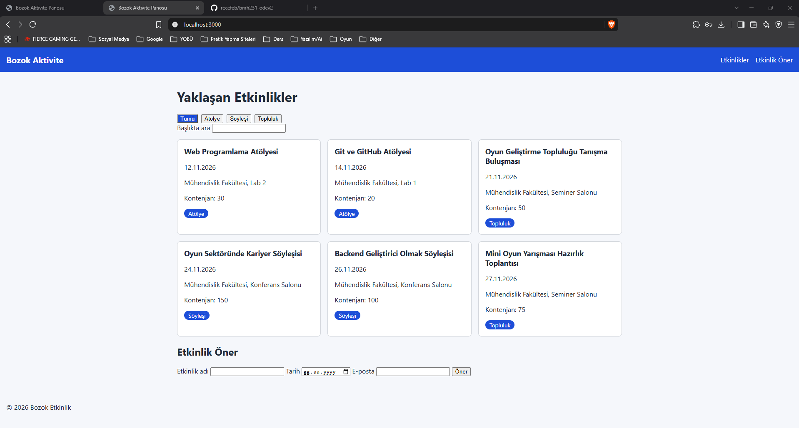

# Kampüs Etkinlik Panosu

BMH231 Web Programlama dersi Ödev 2 için hazırlanmış, kampüs etkinliklerini listeleyen küçük bir web uygulamasıdır. Ön yüz HTML, CSS ve JavaScript ile; sunucu ise yalnızca Node.js'in yerleşik `http`, `fs` ve `path` modülleriyle yazılmıştır. Hiçbir harici paket, framework veya CSS kütüphanesi kullanılmamıştır.

Sayfa, etkinlikleri sunucudaki JSON API'den `fetch` ile çeker; türe göre filtreleme, başlıkta arama ve etkinlik öner formu (istemci tarafı doğrulamalı) sunar.



## Kurulum ve çalıştırma

Gereksinim: [Node.js](https://nodejs.org) kurulu olmalıdır. Harici bağımlılık olmadığı için `npm install` gerekmez.

```bash
git clone https://github.com/recefeb/bmh231-odev2.git
cd bmh231-odev2
npm start
```

Ardından tarayıcıda <http://localhost:3000> adresini açın. Sunucuyu durdurmak için terminalde `Ctrl+C` kullanın.

## API uç noktaları

| Yöntem | Yol | Açıklama | Başarılı yanıt | Hata yanıtı |
|---|---|---|---|---|
| GET | `/api/etkinlikler` | Tüm etkinlikleri JSON dizisi olarak döndürür | 200 | – |
| GET | `/api/etkinlikler?tur=atolye` | Türe göre filtreler (`atolye`, `soylesi`, `topluluk`) | 200 | – |
| GET | `/api/etkinlikler/:id` | Tek bir etkinliği döndürür (ör. `/api/etkinlikler/3`) | 200 | 404 `{"hata":"Etkinlik bulunamadı"}` |
| GET | `/` ve diğer dosyalar | `public/` klasöründeki statik dosyaları sunar | 200 | 404 (düz metin) |
| GET dışındaki her yöntem | herhangi bir yol | Desteklenmez | – | 405, `Allow: GET` başlığı |

## Proje yapısı

```
bmh231-odev2/
├── sunucu.js          # Node.js http sunucusu ve JSON API
├── etkinlikler.json   # Etkinlik verisi
├── package.json       # npm start betiği
└── public/
    ├── index.html     # Sayfa iskeleti (semantik HTML)
    ├── stil.css       # Stiller (Flexbox, Grid, medya sorgusu)
    └── betik.js       # DOM, filtreleme/arama, form doğrulama, fetch
```
